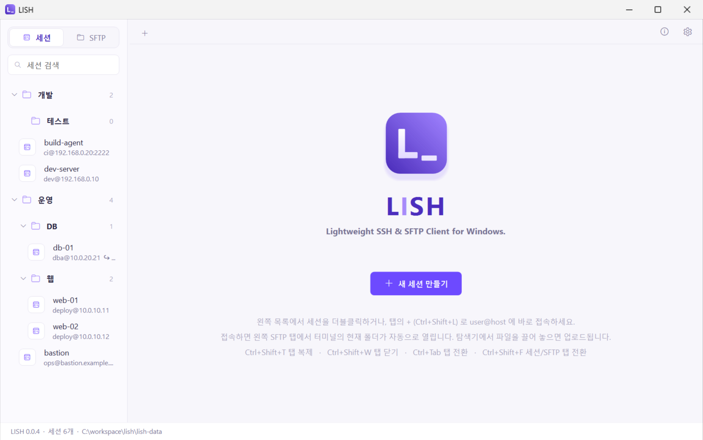

# LISH

**Lightweight SSH & SFTP Client for Windows.**

Windows 10/11용 경량 SSH·SFTP GUI 클라이언트입니다 (C# WinForms, .NET Framework 4.8).
탭 방식 터미널, 세션 트리, 사이드바 SFTP 브라우저를 하나의 실행 파일에 담았습니다.



## 실행 환경 · 배포

- **Windows 10 (1903 이상) / Windows 11**
- **.NET Framework 4.8** — 위 OS에 기본 탑재되어 별도 설치가 필요 없습니다.
- **`dist\lish.exe` 파일 하나만 복사하면 실행됩니다.** SSH.NET 등 의존 DLL이 exe에 내장되어 있습니다.
- 인터넷 연결, 관리자 권한, 레지스트리 등록 모두 불필요 → **사내망(오프라인) 환경에서 그대로 사용** 가능
- 포터블 모드: exe 옆에 `lish-data` 폴더를 만들면 설정을 그 폴더에 저장합니다 (USB/공유 폴더 사용 시).
- 명령줄 인자로 접속 대상을 넘기면 시작하면서 바로 탭을 엽니다: `lish.exe admin@10.0.0.11:2222` 또는 `lish.exe web-01` (저장된 세션 이름)

## 기능

| 기능 | 설명 |
|---|---|
| 탭 | 여러 세션을 탭으로 열기, 탭 복제, 다시 접속, 다른 탭 모두 닫기, 탭별 연결 상태 표시. 탭 우클릭 → "오른쪽에 분할로 보기" 로 두 탭을 좌우로 나란히 (탭 바에서 한 그룹으로 묶임, 활성 칸은 보라색 테두리, 경계선 끌어 폭 조절) |
| 빠른 접속 | 탭 바의 `+` 또는 `Ctrl+Shift+L` → `user@host:port` 또는 세션 이름 입력 |
| 세션 트리 / 폴더 | 폴더 안에 하위 폴더를 만들어 세션 정리 (새 폴더·이름 바꾸기(F2)·삭제(Del)·끌어 놓기로 세션/폴더 이동), 검색, 더블클릭 접속, 편집·복제·주소 복사·삭제, 폴더 전체 접속 |
| 인증 | 공개키(ed25519/ecdsa/rsa, 미지정 시 `~/.ssh/id_*` 자동 사용, 키 암호 입력 지원), 비밀번호, keyboard-interactive / OTP |
| 비밀번호 | 저장하지 않음. 필요할 때마다 입력 (예전 버전이 저장한 비밀번호는 시작할 때 `hosts.json` 에서 지움) |
| 호스트 키 검증 | OpenSSH `known_hosts` 형식 호환(해시 항목 포함), `%USERPROFILE%\.ssh\known_hosts`도 함께 참조, 처음 보는 키는 확인 대화상자, 키 변경 시 차단 |
| 사이드바 탭 | 왼쪽 사이드바 위의 **세션 \| SFTP** 탭 (MobaXterm 방식). 세션 탭 = 검색 + 세션 트리 |
| SFTP (사이드바) | 선택한 터미널 탭의 서버를 **연결되면 자동으로** 열고, **터미널 셸의 현재 폴더**에서 시작(모르면 홈). 탭을 바꾸면 그 탭의 SFTP 로 바뀌고 폴더/상태는 탭마다 유지. 아이콘 도구 모음(상위·홈·새로 고침·새 폴더·업로드·다운로드) + 경로 입력줄, 업로드/다운로드, 이름 바꾸기, 삭제, 경로 복사 |
| 터미널 폴더 따라가기 | SFTP 탭 아래 스위치(기본 켬). 터미널에서 `cd` 하면 SFTP 목록도 그 폴더로 이동. 서버에 명령을 보내지 않고 셸이 알려 주는 현재 폴더(OSC 7)만 사용하므로 셸 설정이 필요 ([설정 방법](#터미널-폴더-따라가기-설정-osc-7)). 전송·경로 입력·이름 바꾸기 중에는 끝난 뒤 따라감. SFTP 에서 직접 옮긴 폴더는 셸이 다시 `cd` 할 때까지 유지 |
| 끌어 놓기 | 탐색기의 파일·폴더를 SFTP 목록(빈 곳 포함)에 끌어 놓으면 현재 폴더로 업로드 (보라 테두리 + '놓으면 업로드 → 경로' 띠로 표시). 목록에서 탐색기로 끌면 다운로드 |
| 터미널 | xterm 호환 (256색/트루컬러, 대체 화면, 스크롤 영역, 선문자, 마우스 모드, bracketed paste, 창 제목) — vim/top/htop 등 사용 가능, 창 크기 자동 동기화 |
| 한글 | 한글 2칸 폭 표시, 한글 IME 조합 표시, 문자셋 UTF-8 / CP949 / EUC-KR 선택 (레거시 서버) |
| 복사/붙여넣기 | 드래그 선택 시 자동 복사(옵션), 오른쪽 클릭 붙여넣기(PuTTY 방식, 옵션), 여러 줄 붙여넣기 확인(옵션) |
| Keepalive | 기본 30초 — 사내 방화벽의 유휴 세션 끊김 방지 (세션별 설정, 0 = 끔) |
| 설정 | 탭 바 오른쪽 끝 톱니바퀴 — 글꼴, 글꼴 크기, 스크롤백 줄 수 등 |
| 정보 | 톱니바퀴 옆 ⓘ — 버전, 빌드 커밋 해시, 라이선스, 내장 오픈소스 라이브러리 목록과 고지 |
| 내장 글꼴 | D2Coding(일반·굵게)을 exe에 내장 — PC에 설치되어 있지 않아도 기본 터미널 글꼴로 사용 |

### 세션 편집 항목

- **연결**: 세션 이름, 폴더(목록에서 만든 폴더 중 선택), 호스트(`user@host:port` 형식도 가능), 포트, 사용자
- **인증**: 개인키 파일 (비밀번호는 접속할 때 입력)
- **고급 설정** (기본 접힘, "펼치기" 버튼으로 열기 — 기본값이 아닌 값이 있으면 자동으로 펼침)
  - **터미널**: 문자셋, 터미널 타입(기본 `xterm-256color`), Keepalive(초)
  - **메모**: 설명

## 단축키

### 창 / 탭

| 키 | 동작 |
|---|---|
| `Ctrl+Tab` / `Ctrl+Shift+Tab` | 다음 / 이전 탭 |
| `Ctrl+Shift+T` | 현재 탭 복제 (같은 세션으로 새 연결) |
| `Ctrl+Shift+W` | 현재 탭 닫기 |
| `Ctrl+Shift+N` | 새 세션 |
| `Ctrl+Shift+F` | 사이드바 세션 ↔ SFTP 탭 전환 (탭 우클릭 → 'SFTP 열기' 도 SFTP 탭으로) |
| `Ctrl+Shift+L` | 빠른 접속 |

### 터미널

| 키 | 동작 |
|---|---|
| `Ctrl+Shift+C` | 복사 |
| `Ctrl+Shift+V` / `Shift+Insert` | 붙여넣기 |
| `Shift+PageUp` / `Shift+PageDown` | 스크롤백 한 화면 위 / 아래 |
| `Ctrl+Shift+Home` / `Ctrl+Shift+End` | 스크롤백 맨 위 / 맨 아래 |

### 세션 목록

| 키 | 동작 |
|---|---|
| 더블클릭 | 접속 |
| `F2` | 세션 편집 |
| `Delete` | 세션 삭제 |

### SFTP (사이드바)

| 키 | 동작 |
|---|---|
| `Enter` / 더블클릭 | 폴더 열기 / 파일 다운로드 |
| `Backspace` | 상위 폴더 |
| `F5` | 새로 고침 |
| `F2` | 이름 바꾸기 |
| `Delete` | 삭제 |
| 경로 입력줄 `Enter` / `Esc` | 그 경로로 이동 / 입력 취소 |

### 터미널 폴더 따라가기 설정 (OSC 7)

LISH 는 서버에서 아무 명령도 자동으로 실행하지 않습니다. 대신 셸이 프롬프트를 띄울 때 터미널로 보내는
현재 폴더 신호(OSC 7)를 읽어 SFTP 목록을 옮깁니다. 서버의 셸 설정에 다음을 추가하세요.

```sh
# bash (~/.bashrc)
PROMPT_COMMAND='printf "\e]7;file://%s%s\a" "$HOSTNAME" "$PWD"'

# zsh (~/.zshrc)
precmd() { printf '\e]7;file://%s%s\a' "$HOST" "$PWD" }
```

Fedora/RHEL 계열처럼 `/etc/profile.d/vte.sh` 가 이미 OSC 7 을 보내는 환경은 설정 없이 동작합니다.
처음 신호를 보낸 호스트와 이름이 다른 호스트(터미널 안에서 다시 ssh 로 들어간 서버)의 신호는 무시합니다.

## 데이터 위치

우선순위: `LISH_HOME` 환경변수 > exe 옆 `lish-data\` (포터블) > `%APPDATA%\Lish\`

| 파일 | 내용 |
|---|---|
| `hosts.json` | 세션 목록 (비밀번호는 저장하지 않음) |
| `folders.json` | 세션 폴더 목록 (빈 폴더 포함). 세션의 폴더 경로는 `hosts.json` 의 `Group` 에 `상위/하위` 형식으로 저장 |
| `settings.json` | 글꼴, 스크롤백, 복사/붙여넣기 옵션, 창 위치·크기, 사이드바 너비(세션/SFTP 탭별), 터미널 폴더 따라가기 |
| `known_hosts` | 신뢰한 호스트 키 (새로 승인한 키는 여기에만 추가) |

현재 사용 중인 데이터 폴더는 탭이 없을 때 하단 상태바에 표시됩니다.

## 빌드 (개발 PC)

.NET SDK 8 이상 필요 (빌드 PC만, 실행 PC는 불필요).

```
powershell -ExecutionPolicy Bypass -File build.ps1
```

- 결과물: `dist\lish.exe` (+ `lish.exe.config`, `D2Coding-OFL.txt`, `THIRD-PARTY-NOTICES.txt`)
- `src\Lish\assets\lish.ico`가 없으면 빌드된 `lish.exe --make-icon`으로 앱 아이콘을 생성한 뒤 다시 빌드합니다.
- 의존 DLL과 D2Coding 글꼴(gzip 압축)은 빌드 시 exe 리소스로 내장되므로 `lish.exe` 하나로 배포됩니다.
- D2Coding 은 NAVER의 SIL Open Font License 1.1 글꼴입니다. 재배포 시 `D2Coding-OFL.txt`(원본: `src\Lish\assets\fonts\OFL.txt`)를 함께 넣으세요.

## 오픈소스 라이선스

LISH 는 GPL-3.0 으로 배포됩니다. exe 에 내장된 라이브러리(SSH.NET, BouncyCastle.Cryptography, .NET 런타임 보조 라이브러리 — 모두 MIT)와
D2Coding 글꼴(OFL-1.1)의 고지는 [THIRD-PARTY-NOTICES.txt](THIRD-PARTY-NOTICES.txt) 에 있고, 앱의 **정보(ⓘ) → 오픈소스 고지 전체 보기**에서도 볼 수 있습니다.
정보 창의 라이브러리 목록은 빌드할 때 실제로 내장되는 NuGet 패키지에서 자동으로 만들어집니다. 의존성을 바꾸면 `THIRD-PARTY-NOTICES.txt` 도 함께 갱신하세요.

## 다운로드 · 릴리스

- 빌드된 실행 파일은 [Releases](https://github.com/struggler-labs/lish/releases)에서 받습니다 (`lish.exe` 단독 또는 `lish-vX.Y.Z-win.zip`, `SHA256SUMS.txt`).
- 변경 내역: [CHANGELOG.md](CHANGELOG.md)
- 릴리스 절차: PR 에서 `src/Lish/Lish.csproj` 의 `<Version>` 을 올리고 `CHANGELOG.md` 에 같은 버전 항목을 추가 → `main` 에 병합되면
  GitHub Actions(`.github/workflows/release.yml`)가 빌드 후 `v<버전>` 태그와 릴리스를 자동으로 만듭니다. 이미 있는 버전이면 건너뜁니다.
- PR 마다 `.github/workflows/build.yml` 이 빌드를 검사하고 exe 를 아티팩트로 남깁니다.

사내 빌드 PC가 인터넷이 막혀 있다면, 외부 PC에서 한 번 `dotnet restore` 후
`%USERPROFILE%\.nuget\packages`의 `ssh.net`, `bouncycastle.cryptography` 등을 사내 NuGet 미러/로컬 폴더로 옮기세요.
